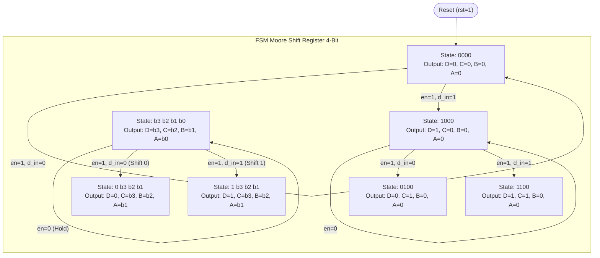

# Dokumentasi Training 5: Shift Register 4-Bit & Konfigurasi OpenLane

Repositori ini memuat implementasi modul **Shift Register 4-bit Serial-In Parallel-Out (SIPO)** berbasis **Finite State Machine (FSM) Moore**, pengujian di FPGA Nexys 4, serta alur otomatisasi konversi RTL ke GDSII (Layout Chip) menggunakan **OpenLane 2** (PDK SkyWater 130nm).

---

## 1. Arsitektur & State Diagram FSM Moore: `shift_register_4bit`

### A. Konsep Model FSM Moore
Pada model **FSM Moore**, nilai output sirkuit **hanya bergantung pada State saat ini (*Present State*)**, dan tidak terpengaruh secara langsung oleh input transien.
Pada modul `shift_register_4bit`:
- **State Internal**: Terdiri dari 4 flip-flop yang menyimpan bit $\{D_{ps}, C_{ps}, B_{ps}, A_{ps}\}$.
- **Output Fisik**: $\{D, C, B, A\}$ dihubungkan langsung dari register state saat ini:
  $$D = D_{ps}, \quad C = C_{ps}, \quad B = B_{ps}, \quad A = A_{ps}$$
- **Input Pengendali**:
  - `clk` : Clock (memicu transisi state pada *rising edge*).
  - `rst` : Asynchronous Reset (*Active-High*).
  - `en`  : Enable pergeseran data ($1 = \text{Geser}, 0 = \text{Hold/Freeze}$).
  - `d_in`: Bit serial baru yang dimasukkan ke register $D$.

---

### B. Analisis 3 Blok Kode Verilog (FSM Moore Standard)

Arsitektur kode pada [`shift_register_4bit.v`](shift_register_4bit/src/shift_register_4bit.v) dibagi secara modular menjadi 3 blok standar FSM:

1. **Blok 1: State Memory (Sequential Logic)**
   ```verilog
   always @(posedge clk or posedge rst) begin
       if (rst) begin
           Aps <= 1'b0; Bps <= 1'b0; Cps <= 1'b0; Dps <= 1'b0;
       end else begin
           Aps <= Ans;  Bps <= Bns;  Cps <= Cns;  Dps <= Dns;
       end
   end
   ```
   *Fungsi:* Menyimpan *Present State* (PS) ke register flip-flop saat terjadi *rising edge* clock (`posedge clk`), serta mengembalikan seluruh state ke `0000` secara asinkron saat `rst = 1`.

2. **Blok 2: Next State Logic (Combinational Logic)**
   ```verilog
   always @(*) begin
       // Default: tahan nilai saat ini (Hold)
       Ans = Aps; Bns = Bps; Cns = Cps; Dns = Dps;
       
       // Pergeseran saat Enable aktif
       if (en) begin
           Ans = Bps;
           Bns = Cps;
           Cns = Dps;
           Dns = d_in;
       end
   end
   ```
   *Fungsi:* Menghitung *Next State* (NS). Jika `en = 1`, data digeser ke arah bit $A$ ($D \rightarrow C \rightarrow B \rightarrow A$) dan bit baru `d_in` dimasukkan ke $D$. Jika `en = 0`, state tertahan (*freeze*).

3. **Blok 3: Output Logic (Pure Moore)**
   ```verilog
   assign A = Aps;
   assign B = Bps;
   assign C = Cps;
   assign D = Dps;
   ```
   *Fungsi:* Memetakan nilai *Present State* langsung ke pin output sirkuit. Karena tidak ada logika kombinasi tambahan dari pin input luar, blok ini murni berkarakteristik Moore.

---

### C. Tabel Eksitasi State (State Transition Table)

| Kondisi Reset | Enable (`en`) | Data In (`d_in`) | Present State $\{D_{ps}, C_{ps}, B_{ps}, A_{ps}\}$ | Next State $\{D_{ns}, C_{ns}, B_{ns}, A_{ns}\}$ | Output $\{D, C, B, A\}$ | Keterangan |
| :---: | :---: | :---: | :---: | :---: | :---: | :--- |
| `1` | `X` | `X` | $b_3 b_2 b_1 b_0$ | `0 0 0 0` | `0 0 0 0` | Asynchronous Reset |
| `0` | `0` | `X` | $b_3 b_2 b_1 b_0$ | $b_3 b_2 b_1 b_0$ | $b_3 b_2 b_1 b_0$ | Hold / Freeze State |
| `0` | `1` | `0` | $b_3 b_2 b_1 b_0$ | `0` $b_3 b_2 b_1$ | $b_3 b_2 b_1 b_0$ | Geser data dengan memasukkan bit `0` |
| `0` | `1` | `1` | $b_3 b_2 b_1 b_0$ | `1` $b_3 b_2 b_1$ | $b_3 b_2 b_1 b_0$ | Geser data dengan memasukkan bit `1` |

---

### D. State Transition Diagram (Diagram FSM Moore)

Berikut adalah visualisasi State Diagram FSM Moore pergeseran aliran data:



> **Ciri Khas Moore**: Di dalam lingkaran/kotak setiap state tercantum nilai outputnya, karena output melekat pada state saat ini.

---

## 2. Penjelasan Kode Konfigurasi OpenLane: `config.json`

File konfigurasi [`shift_register_4bit/config.json`](shift_register_4bit/config.json) digunakan oleh toolchain **OpenLane 2** untuk mengotomatisasi seluruh tahapan fabrikasi chip ASIC dari Verilog hingga layout GDSII.

```json
{
    "DESIGN_NAME": "shift_register_4bit",
    "VERILOG_FILES": ["dir::src/shift_register_4bit.v"],
    "CLOCK_PORT": "clk",
    "CLOCK_PERIOD": 10.0,
    "RESET_PORT": "rst",
    "RESET_ACTIVE_VALUE": 1,
    "FP_CORE_UTIL": 20,
    "FP_ASPECT_RATIO": 1,
    "FP_IO_HLAYER": "met3",
    "FP_IO_VLAYER": "met2",
    "GLB_RESIZER_TIMING_OPTIMIZATIONS": true,
    "SYNTH_STRATEGY": "AREA 0",
    "DIE_AREA": "0 0 100 100",
    "CORE_AREA": "10 10 90 90",
    "RUN_KLAYOUT_XOR": false,
    "QUIT_ON_XOR_ERROR": false
}
```

---

### Penjelasan Baris-demi-Baris Parameter:

| Parameter | Nilai | Fungsi & Penjelasan Teknis |
| :--- | :--- | :--- |
| **`DESIGN_NAME`** | `"shift_register_4bit"` | Nama modul top-level Verilog yang akan disintesis oleh Yosys. |
| **`VERILOG_FILES`** | `["dir::src/shift_register_4bit.v"]` | Path file RTL yang menjadi sumber desain. Prefix `dir::` menunjuk direktori lokal tempat `config.json` berada. |
| **`CLOCK_PORT`** | `"clk"` | Nama port clock primer desain yang akan dibuatkan Clock Tree Synthesis (CTS) dan dianalisis timing STA-nya. |
| **`CLOCK_PERIOD`** | `10.0` | Target periode clock dalam satuan nanodetik ($10\text{ ns} \rightarrow \text{Target Frekuensi } 100\text{ MHz}$). |
| **`RESET_PORT`** | `"rst"` | Nama port reset global pada desain. |
| **`RESET_ACTIVE_VALUE`** | `1` | Polaritas sinyal reset. Nilai `1` menandakan *Active-High* (sesuai dengan rangkaian tombol pull-down FPGA dan sintesis ASIC). |
| **`FP_CORE_UTIL`** | `20` | Persentase pemanfaatan area inti (*Core Utilization*) sebesar $20\%$. Nilai ini memberi ruang yang sangat longgar ($80\%$ ruang kosong) untuk routing metal tanpa potensi kemacetan (*congestion*). |
| **`FP_ASPECT_RATIO`** | `1` | Rasio bentuk geometri floorplan chip ($\text{Tinggi} : \text{Lebar} = 1:1$ atau bujur sangkar). |
| **`FP_IO_HLAYER`** | `"met3"` | Menetapkan layer metal 3 (`met3`) untuk routing pin input/output pada sisi horizontal chip. |
| **`FP_IO_VLAYER`** | `"met2"` | Menetapkan layer metal 2 (`met2`) untuk routing pin input/output pada sisi vertikal chip. |
| **`GLB_RESIZER_TIMING_OPTIMIZATIONS`** | `true` | Mengaktifkan optimasi ukuran buffer/inverter oleh tool Resizer selama penempatan sel global guna mencegah pelanggaran *hold/setup timing*. |
| **`SYNTH_STRATEGY`** | `"AREA 0"` | Menginstruksikan Yosys dan ABC untuk mengoptimalkan sintesis gerbang logika dengan target luas silikon seminimal mungkin. |
| **`DIE_AREA`** | `"0 0 100 100"` | Dimensi fisik total batas terluar chip: $(X_1\ Y_1\ X_2\ Y_2) = (0, 0)$ hingga $(100, 100)\ \mu\text{m}$. Luas total chip adalah $100\times100\ \mu\text{m} = 0.01\text{ mm}^2$. |
| **`CORE_AREA`** | `"10 10 90 90"` | Area dalam chip tempat sel-sel standar ditempatkan: dari $(10, 10)$ hingga $(90, 90)\ \mu\text{m}$. Selisih $10\ \mu\text{m}$ di setiap sisi dialokasikan untuk ring suplai daya ($V_{DD}/V_{SS}$) dan bantalan pin I/O. |
| **`RUN_KLAYOUT_XOR`** | `false` | Mematikan verifikasi XOR geometris layout vs netlist di KLayout untuk mempercepat flow pada skala modul kecil. |
| **`QUIT_ON_XOR_ERROR`** | `false` | Mencegah flow berhenti otomatis jika pengecekan XOR opsional mendeteksi perbedaan kecil pada fill cell. |

---

### Ilustrasi Visual Die Area vs Core Area:

```text
 100 um ┌────────────────────────────────────────────────────────┐  DIE_AREA (100 x 100 um)
        │                       Margin (10 um)                   │
  90 um │      ┌──────────────────────────────────────────┐      │
        │      │                                          │      │
        │      │                                          │      │
        │      │              CORE_AREA                   │      │
        │      │          (80 x 80 um)                    │      │
        │      │   [ Tempat Standard Cells & Flip-Flop ]  │      │
        │      │                                          │      │
        │      │                                          │      │
  10 um │      └──────────────────────────────────────────┘      │
        │                       Margin (10 um)                   │
   0 um └────────────────────────────────────────────────────────┘
        0 um   10 um                                      90 um  100 um
```

---

## 3. Hasil Layout GDSII

Hasil akhir kompilasi RTL to GDSII OpenLane 2 tersimpan di:
* **GDSII Layout:** [`shift_register_4bit/runs/RUN_2026-11-06_18-14-53/final/gds/shift_register_4bit.gds`](shift_register_4bit/runs/RUN_2026-11-06_18-14-53/final/gds/shift_register_4bit.gds)
* **SPICE Netlist (Post-Layout Parasitic Extraction):** [`shift_register_4bit/runs/RUN_2026-11-06_18-14-53/final/spice/shift_register_4bit.spice`](shift_register_4bit/runs/RUN_2026-11-06_18-14-53/final/spice/shift_register_4bit.spice)
